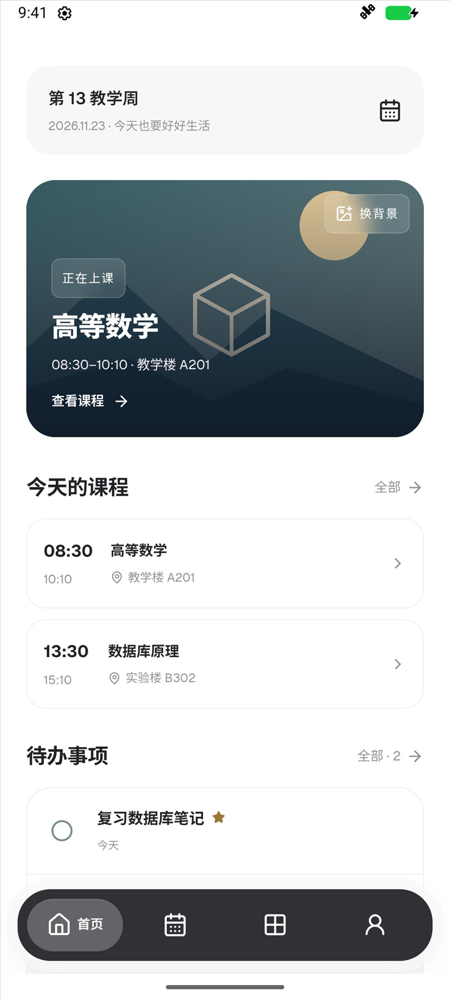
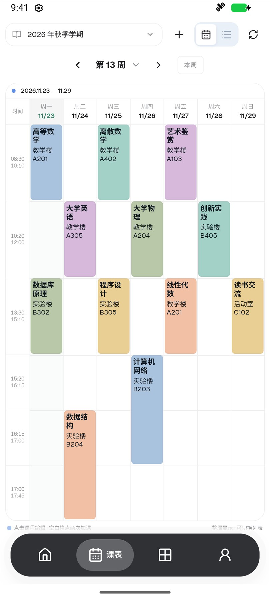
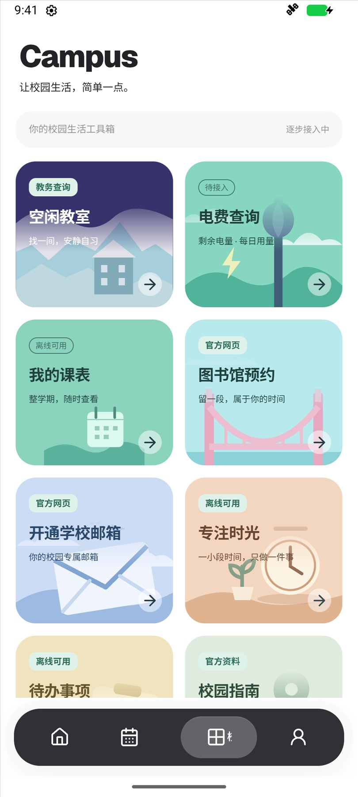
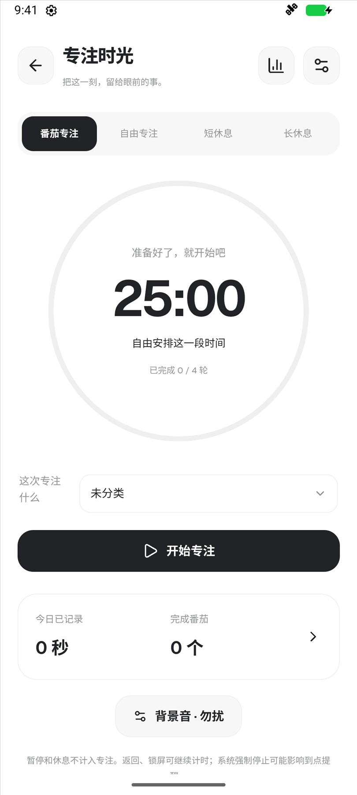
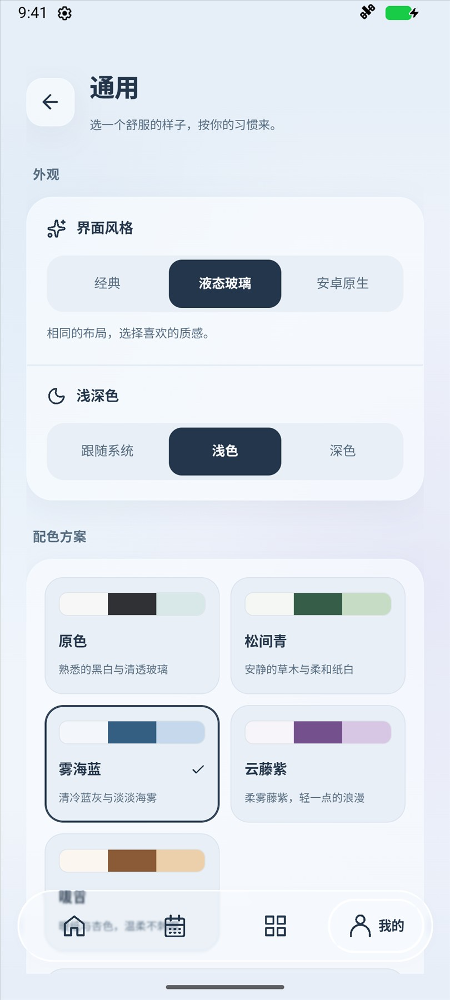
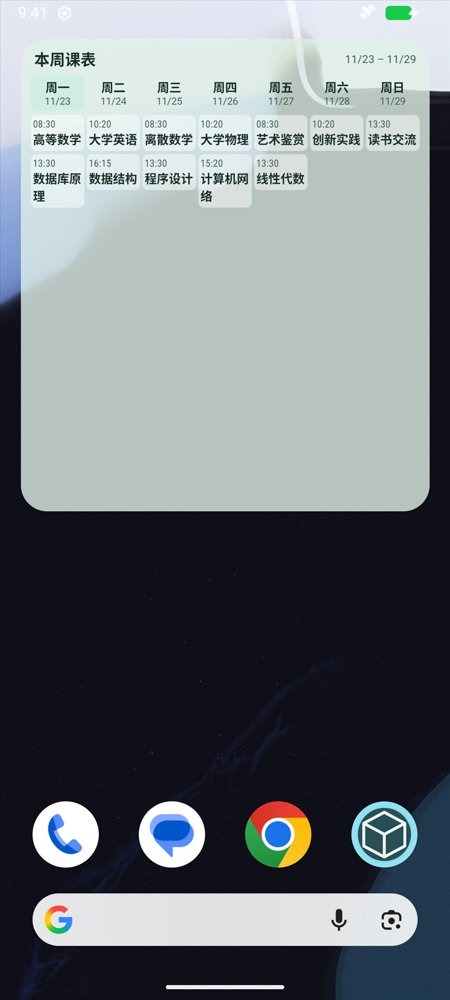

# HENUBox · 河小盒

面向河南大学学生的 Android 校园工具。保存课表后可以离线查看，也能从应用里查空闲教室、打开图书馆预约，或安排自己的待办和专注时间。应用免费、无广告，由个人维护。

[下载 APK](https://github.com/moonquake25104/HENUBox/releases/download/v0.1.3/HENUBox-0.1.3-artwork.apk) · [更新记录](docs/releases/v0.1.3.md) · [反馈问题](https://github.com/moonquake25104/HENUBox/issues)

## 能做什么

- **看课表、收上课提醒** — 从学校教务保存课表，也可以手动加课、修改时间和地点。支持 18 周、五天或七天视图，以及郑州、金明、明伦三个校区的作息。首页显示今日课程。开启提醒后，可以选提前 5、10、15 或 30 分钟通知。
- **把课程放到桌面** — 可添加「今明课表」「五天课表」「七天课表」和「专注时光」小组件。五天和七天版可以同时放置，背景有三档透明度。
- **查校园信息、办常用事项** — 登录教务后可按楼栋、日期和节次查询空闲教室。可打开学校的图书馆预约、邮箱开户页面，也能在校园指南查看校历、校区地图、校内电话、校车和进校预约。
- **安排学习和生活** — 用番茄钟或正计时专注，可选白噪音和勿扰。用待办、倒计时、倒数日和计划表记下要做的事，首页按已有内容展示。待办和专注记录支持导出和恢复。
- **自定义界面** — 可在经典、液态玻璃和安卓原生三种风格间切换，搭配五套配色和浅色、深色或跟随系统。首页卡片也可以换成自己的图片或短视频。

## 界面预览

以下截图均来自 Android 模拟器，课表和待办为演示数据。点击任意截图可查看大图。

<p align="center">
  <a href="docs/images/home.jpg"></a>
  <a href="docs/images/timetable.jpg"></a>
</p>
<p align="center"><sub>首页 · 周课表</sub></p>

<p align="center">
  <a href="docs/images/campus.jpg"></a>
  <a href="docs/images/focus.jpg"></a>
</p>
<p align="center"><sub>校园服务 · 专注时光</sub></p>

<p align="center">
  <a href="docs/images/appearance.jpg"></a>
  <a href="docs/images/weekly-widget.jpg"></a>
</p>
<p align="center"><sub>外观设置 · 七天课表小组件</sub></p>

截图用于展示应用功能，其中的第三方素材归原权利人所有。如需联系维护者，可通过 GitHub 主页反馈。 [维护者主页](https://github.com/moonquake25104)

## 下载与安装

- 下载 Release 附件中的 APK。系统要求 Android 9 及以上，arm64-v8a。 [GitHub Releases](https://github.com/moonquake25104/HENUBox/releases)
- 覆盖安装要求新旧 APK 签名一致，满足条件即可保留本机课表、待办、专注记录和自定义背景。

## 隐私与安全

HENUBox 是非学校官方应用。学校账号由你在学校页面登录，教务会话使用 Android Keystore 加密保存在本机。课表、待办、专注记录和自选媒体保存在设备，应用不会主动上传这些记录。图书馆、邮箱等外部网页仍适用各自的隐私规则。 [隐私说明](docs/PRIVACY.md)

## 参与贡献

欢迎反馈使用问题、测试不同机型，也欢迎改进教务解析、界面、无障碍和文档。反馈时建议提供机型、系统版本和复现步骤，去除姓名、学号、凭据和个人课表。安全问题请走私下反馈渠道。 [提交 Issue](https://github.com/moonquake25104/HENUBox/issues) · [贡献说明](CONTRIBUTING.md) · [安全反馈](SECURITY.md)

## 开发与构建

界面使用 React、TypeScript 和 Vite，Android 壳使用 Capacitor、Java 和 Kotlin，课表解析使用 Go。 [开发说明](docs/BUILDING.md)

```powershell
powershell.exe -NoProfile -ExecutionPolicy Bypass -File scripts/build-android.ps1 -InstallDependencies
```

构建产物位于 `App/mobile/android/app/build/outputs/apk/`。 [发布说明](docs/PUBLISHING.md)

## 许可与致谢

代码沿用 Kairos 的 MIT 许可，保留原始版权及 HENUBox 维护者署名。第三方源码、依赖与素材的许可也可在应用内离线查看。 [MIT 许可证](LICENSE) · [第三方致谢](THIRD_PARTY_NOTICES.md)

感谢 Kairos、React、Capacitor、Radix UI、Lucide、AndroidX/Compose、Kotlin、Go、AndroidLiquidGlass/Backdrop、字体与音频作者，以及参与测试和分享建议的朋友。
