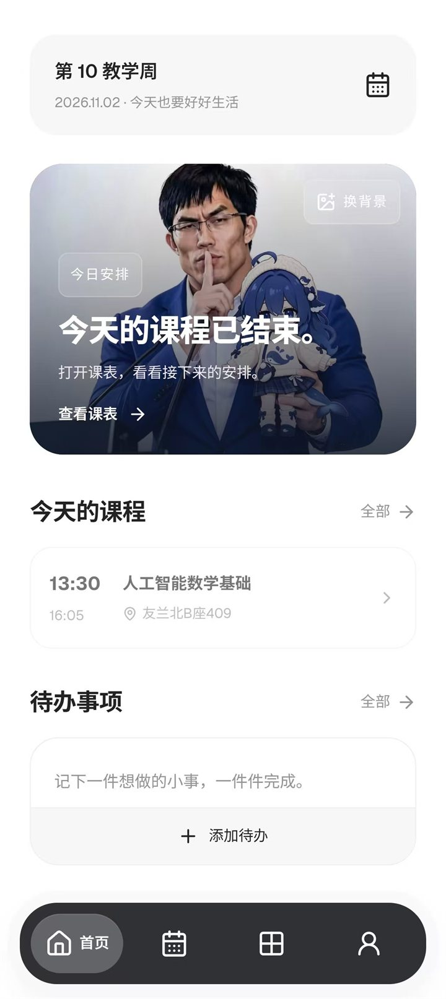
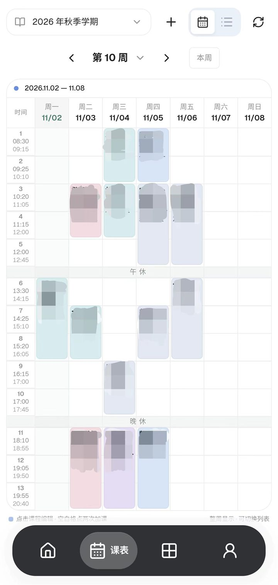
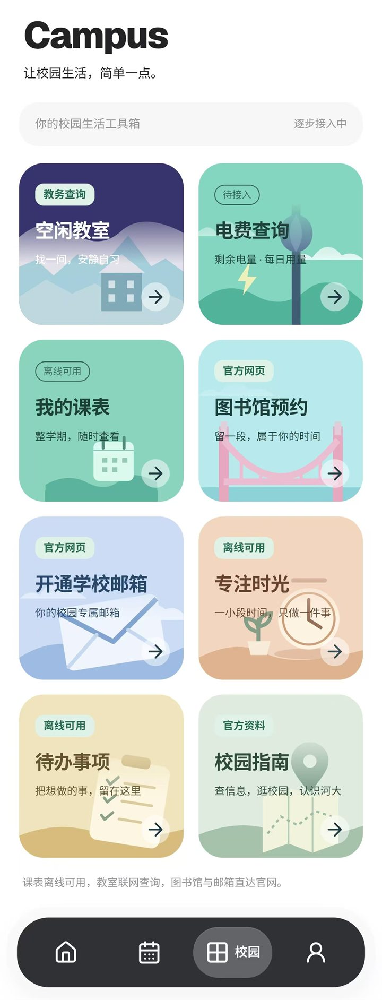
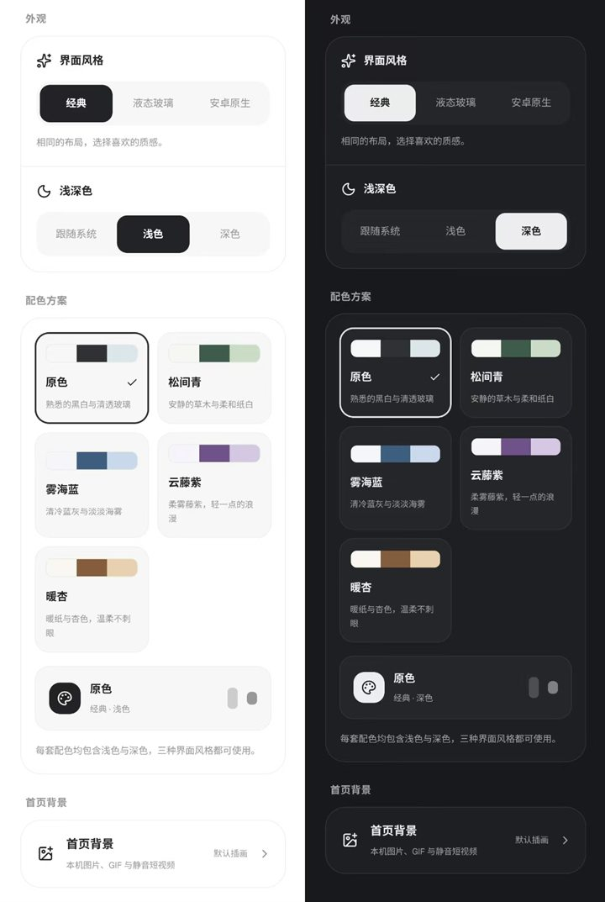

# HENUBox 河小盒

> 把课表、校园服务和日常小事，装进一个盒子里。

面向河南大学校园生活的 Android 工具箱。非学校官方应用，免费、无广告。

[下载最新版](https://github.com/moonquake25104/HENUBox/releases/latest) · [问题反馈](https://github.com/moonquake25104/HENUBox/issues) · [参与贡献](CONTRIBUTING.md)

## 为什么是河小盒

大学里的信息常常散落在教务系统、图书馆、邮箱和一堆网页里。河小盒想做的事情很简单：把每天真正会用到的部分收在一起，让课表、待办和校园服务触手可及，同时尽量把数据留在你自己的手机上。

## 界面预览

<p align="center">
  
  
</p>
<p align="center"><sub>首页 · 课表</sub></p>
<p align="center">
  
  
</p>
<p align="center"><sub>Campus · 三种外观与五种配色</sub></p>

## 功能

### 课表：一次保存，整学期离线看

- 首次从教务保存后，断网也能查看整学期课表
- 支持 18 周、5 天/7 天显示、校区作息和个人编辑
- 课程可以单独改颜色、时间、地点，临时调整也能自己安排
- 首页直接显示今天要上的课和下一节安排

### 教务：本人登录，按需更新

- 由你在学校官方页面完成登录，App 不要求你把密码交给开发者
- 登录后可更新课表、查询空闲教室
- 教务会话使用 Android Keystore 加密保存在本机

### 校园工具：少开几个网页

- 空闲教室查询
- 图书馆、学校邮箱等官方入口
- 校园指南：校历、校区地图、常用电话、校车、校园信息
- 专注计时与待办清单

### 专注与待办

- 番茄钟、正计时、白噪音和专注记录
- 待办支持今天、重要、逾期等视图
- 通知、提醒和勿扰权限按需申请，不需要时不会打扰

### 三种外观，五种配色

- **经典**：干净、克制，适合日常
- **液态玻璃**：半透明层次和柔和光影
- **安卓原生**：更贴近系统组件的观感
- 配色：原色、松间青、雾海蓝、云藤紫、暖杏
- 支持浅色、深色和跟随系统

### 数据留在本机

课表、待办、专注记录和自定义背景主要保存在设备上；没有开发者广告 SDK，也不会把这些记录主动上传。图书馆、邮箱等外部网页仍适用对应服务方的规则。

## 下载与安装

- 最新版本：[GitHub Releases](https://github.com/moonquake25104/HENUBox/releases)
- 系统要求：Android 9 及以上，arm64-v8a
- 覆盖安装即可保留本机课表、待办、专注记录和自定义背景
- 这是学习交流项目，不提供学校账号代理，也不代表学校官方

## 一起完善河小盒

河小盒目前由个人维护，功能范围保持稳定，优先修复问题和打磨体验。但一个校园工具想真正好用，需要更多使用它的人一起提意见。

欢迎从这些方向参与：

- **反馈问题**：说明机型、系统版本、复现步骤和预期结果；请先去掉姓名、学号、密码、Cookie 和个人课表
- **适配机型**：不同厂商的通知、后台、勿扰和权限策略差异很大，欢迎帮忙测试
- **改进解析**：学校页面和教务系统会变化，遇到解析失败可以提供脱敏后的结构说明
- **界面与交互**：三种外观、配色、排版、动效和无障碍都可以继续打磨
- **文档与测试**：补充构建说明、隐私说明、回归用例，或者帮忙校对文案
- **分享给同学**：如果它确实帮你省了一点时间，欢迎推荐给需要的人

提交代码前请先阅读 [贡献说明](CONTRIBUTING.md)；安全问题请按 [安全反馈](SECURITY.md) 私下联系，不要在公开 Issue 里贴凭据或个人信息。

## 开发与构建

界面使用 React + TypeScript + Vite，Android 壳使用 Capacitor + Java/Kotlin，课表解析使用 Go。具体工具版本、构建命令和测试入口见 [开发说明](docs/BUILDING.md)。

```powershell
powershell.exe -NoProfile -ExecutionPolicy Bypass -File scripts/build-android.ps1 -InstallDependencies
```

构建产物在 `App/mobile/android/app/build/outputs/apk/`。源码结构、模块说明和发布流程分别在 `App/`、`docs/` 和 [发布说明](docs/PUBLISHING.md) 中。

## 隐私与安全

课表、待办、专注记录和自选媒体主要保存在设备；学校登录由用户在学校页面完成，教务会话由 Android Keystore 保护。通知、提醒、勿扰等权限按需申请。详见 [隐私说明](docs/PRIVACY.md) 与应用内“我的 → 关于HENUBox”。

不承诺不存在漏洞。反馈问题时请勿附带凭据、Cookie、学号、个人课表或未脱敏截图。

## 许可与致谢

代码沿用上游 [MIT 许可证](LICENSE)，保留 Kairos 原始版权，并注明 HENUBox 维护者 [moonquake25104](https://github.com/moonquake25104) 的版权。第三方源码、依赖与素材的许可列在 [第三方致谢](THIRD_PARTY_NOTICES.md)，并可在应用内离线查看。

感谢 Kairos、React、Capacitor、Radix UI、Lucide、AndroidX/Compose、Kotlin、Go、AndroidLiquidGlass/Backdrop、字体与音频作者，以及参与测试和分享建议的朋友。
